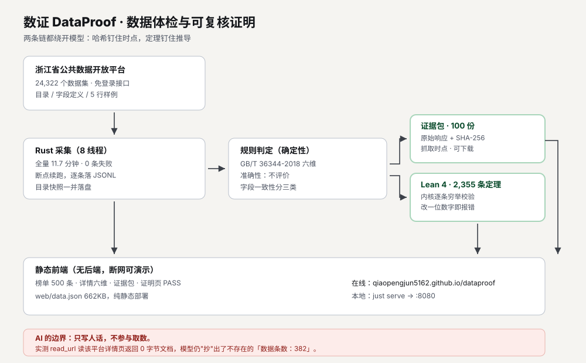

# 数证 DataProof · 项目说明（一页版）

赛道 02 · AI 基础设施与可信数据 · 第五元素 杭州 2026 AI × 数据创新赛

## 一句话

给公共开放数据做体检，并让每一条数值结论都能被机器独立复核。

## 问题

浙江省公共数据开放平台有 24,322 个数据集，官方只公布数量类指标，没有数据集级的质量评价。使用方拿到数据后，无法确认三件事：

- 字段清单写的是不是真的（有一份数据集声明 7 列，实际 92 列）
- 数据还有没有人在维护（超过一半超过 90 天没更新）
- 表里的空值到底是「没有」还是「没填」

这三件事都能用确定性规则检出，但检出的结论没人信——因为报告是可以被改的。所以我们把「结论」和「证据」绑在一起。

## 方案



四层：

1. **采集（Rust）**：8 线程全量拉目录、字段定义、样例。单二进制，无运行时依赖，断点续跑。
2. **规则（确定性）**：对齐 GB/T 36344-2018，只评能自动算的五维；准确性明确写「不评价」。
3. **证据与证明**：接口原始响应逐字节落盘 + SHA-256（钉住时点）；数值结论生成 Lean 4 定理，内核逐条校验（钉住推导）。
4. **呈现（静态站）**：榜单 / 详情 / 证明三页，读 JSON，无后端，断网可演示。

AI 的位置：只写人话解释，**不参与任何取数**。解释层带数字护栏——输出里的每个数字都要和事实逐个比对，对不上就重写，重写仍不合格就不展示。

## 已验证

| 项 | 结果 |
|---|---|
| 全量体检 | 24,322 个数据集，11.7 分钟，0 条详情失败 |
| 样例覆盖 | 19,830 个（81.5%）有样例数据 |
| 时效性 | 滞后中位数 115 天；>90 天 13,665 个（56.2%）；>365 天 6,147 个（25.3%） |
| 完整性 | 空值率均值 6.71%；>30% 有 1,097 个；整列全空 3,976 个（16.3%） |
| 一致性 | 列数不一致 1,244 个；字段集合不一致 12 个；仅命名不一致 28 个 |
| 证据包 | 100 份原始响应，可下载，SHA-256 可复核 |
| 证明 | 2,355 条定理，`lean` 退出码 0；改一位数字内核报错 |
| AI 解释层 | 100 条解读，数字护栏 100/100 通过；空输出/截断/越界都会被拦下 |
| 流水线 | `just smoke` 200 条端到端 39 秒；`just all` 全流程一条命令 |
| CI | 4 个 job：fmt/clippy、单测与黄金文件、Lean 内核、密钥扫描 |

## 未做 / 不声称

- **不评价准确性**：没有权威源可比对，硬评就是编。
- **不处理全量 2.26 亿行**：体检基于表头 + 5 行样例，报告写「样例级」。
- **不证明平台数据为真**：证明对象是「从这份快照推出的计数」，快照哈希钉住时点。
- **不做账号体系、后端、治理平台**。
- **无付费验证**：买方场景（交易所上架审核、提供方自证）尚未实证。

## 三条命令自查

```bash
just check   # 格式 / clippy 零容忍 / 单测 / 黄金文件 / 证明门禁
just smoke   # 200 条端到端：体检 → 榜单 → 解读 → 证据 → 证明
just tamper  # 改一位数字，Lean 内核当场拒绝
```

## 演示

- 在线（静态站，无需环境）：https://qiaopengjun5162.github.io/dataproof/
- 本地：`just serve` → http://localhost:8080
- 代码：https://github.com/qiaopengjun5162/dataproof
- 6 分钟讲稿：`docs/PITCH.md`

## 数字的时点

全部数字对应 **2026-11-14** 的一次抓取，快照已冻结。重跑 `just all` 会用当天数据刷新，数字会漂移。
